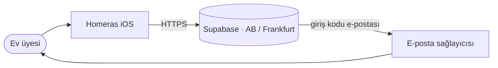
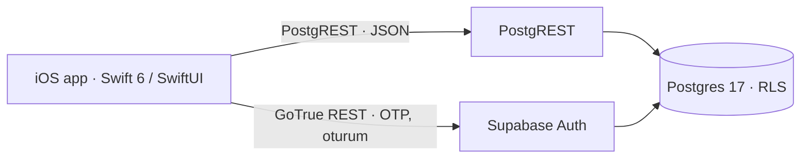
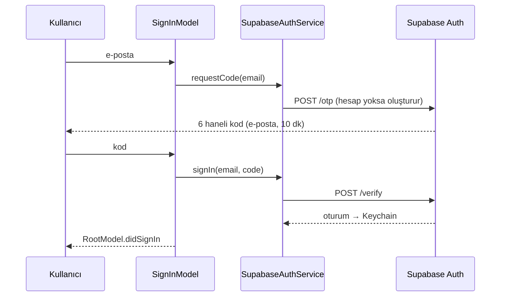

# Mimari Genel Bakış

"Ne var ve nasıl bağlı" sorusunu cevaplar; "neden" için [decisions/](../decisions/) klasörüne bakın.

## Sistem bağlamı (C4 – Context)

## Container'lar (C4 – Container)

| Container | Teknoloji | Sorumluluk | Kod yeri |
|---|---|---|---|
| iOS app | Swift 6, SwiftUI, Observation | Arayüz, domain kuralları, oturum | `App/`, `Packages/AppModules/` |
| Supabase Auth | GoTrue | E-posta OTP, oturum ve refresh token | `supabase/config.toml` (`[auth]`) |
| PostgREST | Supabase API | Tablolara ve RPC'lere REST erişimi; RLS kullanıcının JWT'siyle çalışır | — |
| Postgres | Postgres 17 | Veri, RLS politikaları, `security definer` fonksiyonlar | `supabase/migrations/` |

Yerel geliştirmede aynı yığın Docker'da çalışır (`make db-start`). Portlar 547xx aralığındadır
(API 54721, DB 54722, Mailpit 54724).

## Modüller ve sınırlar

Kod `Packages/AppModules` paketindedir. Sınırlar `Package.swift` bağımlılıklarıyla derleyici
tarafından zorlanır ([ADR-0001](../decisions/0001-native-ios-with-modular-spm-structure.md)).

| Modül | Sorumluluk | Bağımlı olabilir | Bağımlı olamaz |
|---|---|---|---|
| `Core` | Domain tipleri (`Household`, `ShoppingItem`), değer doğrulama (`HouseholdName`, `EmailAddress`…), port protokolleri (`AuthService`, `HouseholdRepository`, `ShoppingListRepository`), hata tipleri | — (yalnızca Foundation) | SwiftUI, Supabase, diğer tüm modüller |
| `DesignSystem` | Ortak UI: hata mesajları (`userMessage`), `textInput(_:)`, ortak metinler (`Bundle.designSystem`) | `Core` | Feature'lar, adapter'lar |
| `SupabaseBackend` | Core portlarının Supabase uygulaması (`SupabaseServices`), hata/satır eşleme | `Core`, `supabase-swift` | SwiftUI, feature'lar |
| `AuthFeature` | Giriş: `SignInModel` + `SignInView` | `Core`, `DesignSystem` | Adapter'lar, diğer feature'lar |
| `HouseholdFeature` | Ev oluşturma: `CreateHouseholdModel` + `CreateHouseholdView` | `Core`, `DesignSystem` | Adapter'lar, diğer feature'lar |
| `ShoppingFeature` | Ortak liste: `ShoppingListModel` + `ShoppingListView` | `Core`, `DesignSystem` | Adapter'lar, diğer feature'lar |
| `TestSupport` | Test yardımcıları (`LocalizationAudit`); yalnızca test hedeflerine bağlanır | — | Uygulama hedefi |
| App (`App/`) | Composition root (`AppLaunch`, `AppServices`), kök akış (`RootModel`, `RootView`), yapılandırma (`AppConfiguration`) | Tüm modüller | — |

**Bağımlılık yönü:** `App → Feature → DesignSystem → Core` ve `App → SupabaseBackend → Core`.
Core hiçbir şeye bağımlı değildir; feature'lar backend'i yalnızca Core portları üzerinden görür ve
gerçek implementasyonu `AppServices` enjekte eder.

## Veri akışı

### Açılış ve kök akış

`RootModel` ekranı seçer: oturum yoksa giriş; oturum var ama ev yoksa ev oluşturma; ev varsa
alışveriş listesi. Oturum değişiklikleri (`AuthService.sessionUpdates()`) uygulama ömrü boyunca
dinlenir. Sunucu oturumu iptal ederse kullanıcı girişe döner.

### Giriş (e-posta OTP)

### Alışveriş listesine ekleme (idempotent)

1. `ShoppingListModel.addItem()` adı `ShoppingItemName` ile doğrular ve cihazda UUID'li bir
   `ShoppingItemDraft` üretir.
2. `SupabaseShoppingListRepository.add` önce oturumu doğrular (gerekirse token yeniler), sonra
   `INSERT … ON CONFLICT (id) DO NOTHING` gönderir. RLS üyeliği, kolon GRANT'ı ise yazılabilir
   alanları sınırlar.
3. İstek başarısız olursa model taslağı saklar. Tekrar denemede aynı UUID gönderilir, böylece
   sunucuda kopya oluşmaz.

## Kalıcı veri

- **Postgres** (şema: `supabase/migrations/`, testler: `supabase/tests/database/`):

  | Tablo | Ne tutar | Erişim |
  |---|---|---|
  | `households` | Ev (tenant) adı | Üyeler okur; oluşturma yalnızca `create_household()` RPC'siyle |
  | `household_members` | Kullanıcı–ev üyeliği ve rol (`owner`/`admin`/`member`) | Aynı evin üyeleri okur |
  | `shopping_items` | Ortak liste öğesi; `created_by` sunucu atar | Üyeler okur ve ekler; kolon GRANT'ı `id, household_id, name` |

  İndeksler: `household_members(user_id)` (RLS yardımcısı ve "hangi evdeyim" sorgusu),
  `shopping_items(household_id, created_at desc, id desc)` (sayfalı liste). İndeksler her biri ayrı
  migration'da `CREATE INDEX CONCURRENTLY` ile oluşturulur.
- **Cihaz:** Yalnızca oturum, Keychain'de (supabase-swift `KeychainLocalStorage`). Yerel veritabanı
  ve outbox FR-044 diliminde gelecek ([ADR-0005](../decisions/0005-offline-first-sync-with-outbox.md)).

## Kişisel veri envanteri

| Veri | Nerede | Amaç | Silme |
|---|---|---|---|
| E-posta adresi | `auth.users` | Giriş | Hesap silmeyle (FR-007) |
| Kullanıcı kimliği (UUID) | `auth.users`, üyelik ve `created_by` | Yetkilendirme | Hesap silmede üyelik silinir, `created_by` null olur |
| Ev adı, liste öğeleri | `households`, `shopping_items` | Uygulama işlevi | Ev silinince cascade |

`App/PrivacyInfo.xcprivacy` bu tabloyla birlikte güncellenir. Loglarda PII yoktur: sunucu mesajları
`privacy: .private` ile loglanır.

## Dış bağımlılıklar

| Bağımlılık | Amaç | Karar |
|---|---|---|
| Supabase (Auth, PostgREST, Postgres) | Backend | [ADR-0003](../decisions/0003-supabase-backend-in-eu.md) |
| `supabase-swift` 2.55.7 (sürüm sabit) | Supabase istemcisi; yalnızca `SupabaseBackend` modülünde | [ADR-0003](../decisions/0003-supabase-backend-in-eu.md) |
| XcodeGen | `project.yml`'den Xcode projesi | [ADR-0001](../decisions/0001-native-ios-with-modular-spm-structure.md) |
| Supabase CLI + Docker | Yerel yığın, migration ve pgTAP testleri | [ADR-0002](../decisions/0002-single-verify-entry-point-and-ci.md) |
